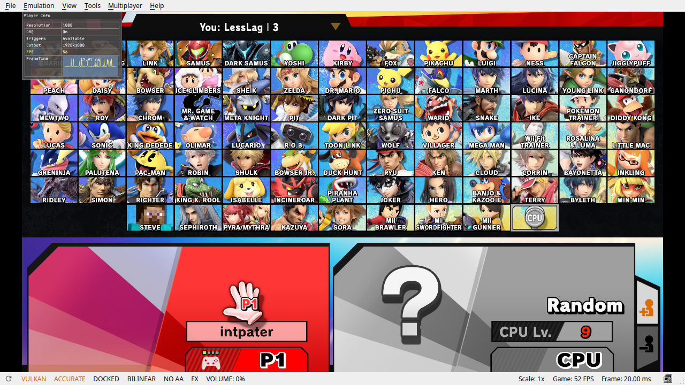
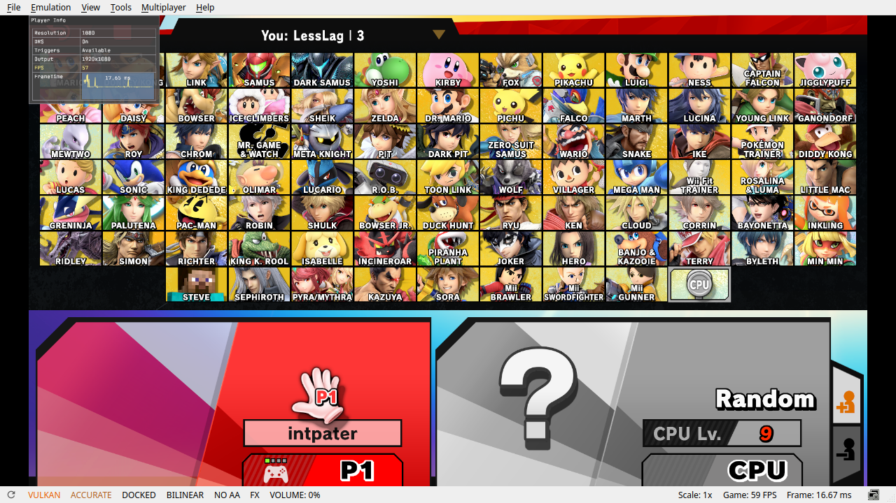

# ssbu-dispatcher-backoff

A small [Skyline](https://github.com/skyline-dev/skyline) plugin for Super
Smash Bros. Ultimate **13.0.5** that stops the game's task dispatcher from
busy-polling six empty job queues while it waits for an unfinished dependency.
The waste is in the game's own code and is largest on the character select
screen, where the main thread spends roughly 5 ms of every frame spinning
while one UI layout animation job runs on a worker thread.

| Before (Eden, 175% CPU quota, LessLag CSS) | After (same boot, same scene, same quota) |
| --- | --- |
|  |  |
| 52–54 fps, 20.0 ms frame, 27.2 CPU ms/frame | 59 fps, 16.7 ms frame, 23.3 CPU ms/frame |

Those two frames come from one emulator session with the diagnostic form of
the fix toggled between captures. Switch screenshots are added after the
hardware test. The full write-up, with call chain, numbers and the hook
contract, is in [docs/ANALYSIS.md](docs/ANALYSIS.md).

## What it does

The dispatcher (`main+0x354a6d0`) scans its pending-dependency records and
then polls three local and three shared priority queues, each behind a
`std::mutex`. When every queue is empty **and** at least one record is still
pending, it goes straight back to the scan instead of waiting on its light
event; completion of the awaited job never signals that event. On a loaded
machine the main thread therefore spends its wait spinning through six
lock/unlock pairs per pass, and a two-image presentation ring cannot hide the
resulting frame-time variance.

This plugin installs one inline hook at `main+0x354ab48`, the instruction the
dispatcher reaches after the sixth probe found no job and released its lock.
The hook reads what the game is about to read anyway and sleeps the calling
thread for a few microseconds when **all** of the following hold:

- the calling thread is the SDK `MainThread`;
- the dispatcher is enabled (context byte `+0x58`, bit 0);
- all six queue sizes are zero;
- the pending vector `[d+0xe0, d+0xe8)` is non-empty and every record's
  32-bit dependency counter is still above zero;
- the ready-to-resume vector `[d+0xf8, d+0x100)` is empty.

Anything else falls through to the game's own rescan immediately. No job,
counter, lock, priority or ordering is changed; the plugin only decides
whether to wait before the game repeats a scan it would have repeated anyway.
The hook is integer-only and performs no allocation, file or log access.

Default cadence: the first 16 idle passes spin exactly as the game does, then
the thread sleeps 5 µs, doubling to a 50 µs cap, on every idle pass until work
appears. Any sign of work resets the streak.

## Install

Copy `libssbu_dispatcher_backoff.nro` to

```text
sd:/atmosphere/contents/01006A800016E000/romfs/skyline/plugins/
```

On the next boot the plugin writes

```text
sd:/ultimate/ssbu_dispatcher_backoff/install.log
```

with the detected game version, the policy in effect, the five instruction
words it found at the hook site and the result: `installed`,
`unsupported_version`, `skipped_site_words_differ` or
`skipped_site_owned_by_another_plugin`.

The same fix is built into
[ssbu-online-deluxe-rewrite](https://git.syntaxbyexample.com/intpa/ssbu-online-deluxe-rewrite)
0.3.0 and later. Both plugins verify the original bytes before patching, so
whichever loads first owns the site and the other one skips. Installing both
is harmless but pointless.

## Tuning

Optional. Create `sd:/ultimate/ssbu_dispatcher_backoff/config.ini`:

```ini
# idle passes to spin before the first sleep (default 16)
spin_passes=16
# after that, sleep on every Nth idle pass (default 1 = every pass)
every_passes=1
# first sleep and the cap of the doubling ramp, in nanoseconds (1000..2000000)
base_ns=5000
max_ns=50000
# minimum gap between the end of one sleep and the next, microseconds (0 = none)
cooldown_us=0
# 1 lets worker-thread dispatchers sleep too (default 0: MainThread only)
all_threads=0
# preset=measured reproduces the diagnostic cadence that produced the numbers
# above: a 1 us request about once per 171 idle passes, from the first pass.
# preset=default restores the defaults. Later keys override a preset.
```

`max_ns=0` disables sleeping while keeping the hook installed. Values outside
the documented ranges are clamped; unknown keys are ignored.

## Evidence summary

Eden (Linux, Vulkan, 1x, isolated profile) with the emulator's own systemd
unit limited to 175% CPU to reproduce the Switch-like pressure. A/B/A means
control, backoff, control on one boot of one binary.

| Scene / profile / quota | FPS A / B / A | CPU ms per frame A / B / A |
| --- | --- | --- |
| Character select, LessLag, 175% | 52.23 / **59.31** / 51.89 | 27.84 / **22.90** / 28.08 |
| Character select, Vanilla, 175% | 59.32 / 60.10 / 59.85 | 26.90 / 23.04 / 26.27 |
| Character select, LLDoubles, 175% | 59.55 / 60.03 / 58.33 | 26.44 / 23.13 / 27.84 |
| Character select, LessLag, unlimited | 59.08 / 60.00 / 59.80 | 24.82 / 23.79 / 24.88 |
| Live match, LessLag, 175% | 57.43 / 59.35 / 59.90 | 20.62 / 18.74 / 19.32 |

Main-core CPU fell from 11.7 to 6.7 ms per frame while the UI worker stayed at
5.7–5.8 ms: the saving is removed polling, not removed work. The production
hook with the default policy was then re-measured the same way: character
select 55.6 → **60.0** → 54.2 fps (off / on / off) at 26.6 → 19.5 → 26.8 CPU
ms per frame, Vanilla 60 with the same CPU saving, live match 59.8 fps at
16.3 CPU ms per frame. These are
emulator measurements; CPU quota competition and JIT lock cost are emulator
artifacts, so the numbers do not transfer to the Switch as-is. The Switch
result is recorded in [docs/ANALYSIS.md](docs/ANALYSIS.md) once measured.

## Safety

- Version gate: the plugin only acts on display version 13.0.5 and only when
  the five original words at the site match.
- Scheduling only: the hook never skips or rewrites game state. That preserves
  the dispatcher's semantics but is not a proof that different timing cannot
  expose a pre-existing race, so linked matches should be checked for desyncs
  like any other timing-affecting mod.
- Latency: a job that completes just after a sleep begins waits for that sleep
  to end, at most `max_ns` plus the kernel's wake latency. With the defaults
  that is under 0.1 ms of a 16.7 ms frame.
- Not covered by the measurements: loading screens and results, other 13.0.x
  images, worker-thread dispatchers (off by default).

## Build

Requires the `skyline-v3` Rust toolchain and `cargo-skyline`.

```text
cargo test
cargo clippy --all-targets -- -D warnings
cargo skyline clippy -- -- -D warnings
cargo skyline build --release
# target/aarch64-skyline-switch/release/libssbu_dispatcher_backoff.nro
```

`src/policy.rs` is the host-tested decision logic; `src/runtime.rs` is the
Switch-only hook. The repository contains no game assets.

## License

MIT. See [LICENSE](LICENSE).
